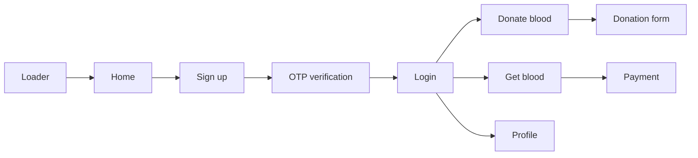

# E-Blood Bank: Blood Chain Supply Management

**A responsive web app that connects blood donors and recipients**, with donate and request flows, OTP verification screens, a profile and a payment page.

> An academic project. I was the lead developer.

## User flow


## Pages
| Page | Purpose |
|---|---|
| `HomePage.html` | Landing page |
| `SignUpPage.html`, `signup_otp.html`, `LoginPage.html` | Registration, 4-digit OTP screen, login |
| `DonateBloodPage.html`, `DonationForm.html` | Donor flow |
| `GetBloodPage.html`, `PaymentPage.html` | Recipient flow |
| `profile.html` | User profile |
| `Loader.html`, `Loader.js` | Loading screen |

## Tech
HTML5 · CSS3 · vanilla JavaScript (including `localStorage`)

## Scope
This repository holds the **front end**. OTP verification and form handling are simulated in the browser; there is no backend or database in this code.

## Run it locally
Open `index.html` (it opens the home page) in a browser, or run:
```bash
npx serve .
```

---
By [Akshat Verma](https://github.com/AKSHATv26)
